# SageAttention for Windows

This fork began as a small set of Windows build and packaging patches for [SageAttention](https://github.com/thu-ml/SageAttention). We kept the patch set minimal while following upstream. Upstream `main` has stayed at its [January 17, 2026 commit](https://github.com/thu-ml/SageAttention/commit/d1a57a546c3d395b1ffcbeecc66d81db76f3b4b5) through November 23, 2026. With kernel fixes still pending and new Windows CUDA and PyTorch builds to support, we now maintain SageAttention 2.2 and SageAttention 3 in this fork.

## Fixes brought over from upstream

- **SageAttention 2.2** uses the current CUDA stream for CUDA Graph replay, applies right-aligned causal masks to unequal Q and K lengths, and zero-fills tail tiles and zero-scale FP8 V channels. We also brought over 64-bit Triton addressing and reduced peak memory by allocating the output after V quantization. [#380](https://github.com/thu-ml/SageAttention/pull/380) · [#372](https://github.com/thu-ml/SageAttention/pull/372) · [#377](https://github.com/thu-ml/SageAttention/pull/377) · [#387](https://github.com/thu-ml/SageAttention/pull/387) · [#384](https://github.com/thu-ml/SageAttention/issues/384)
- **SageAttention 3** applies causal and padding masks in token order after FP4 interleaving, restores the omitted causal key block, and initializes the softmax and output accumulators. It supports native GQA/MQA, pads head widths up to 128, preserves the caller’s K, and chunks long non-causal queries when the correction tensor would exceed the TMA stride limit. Explicit masks and ragged causal lengths with different Q and K padding use SDPA. [#408](https://github.com/thu-ml/SageAttention/pull/408) · [#410](https://github.com/thu-ml/SageAttention/issues/410) · [#406](https://github.com/thu-ml/SageAttention/pull/406) · [#401](https://github.com/thu-ml/SageAttention/pull/401) · [#409](https://github.com/thu-ml/SageAttention/pull/409) · [#394](https://github.com/thu-ml/SageAttention/pull/394) · [#407](https://github.com/thu-ml/SageAttention/pull/407)

## Optimizations in this fork

- **SageAttention 2.2** uses standard E4M3 conversion and, where supported, normalizes attention with row sums from the rounded FP8 probabilities. Paths that return log-sum-exp retain FP32 row sums. [VC-Attention](https://arxiv.org/abs/2609.15810)
- **SageAttention 3** fuses 128-token Q block centering with FP4 quantization for aligned inputs. Each 16-element Q and K block evaluates five E4M3 scales derived from `amax / {6, 5.5, 5, 4.5, 4}`. Each V channel evaluates `amax / 6` and its neighboring finite E4M3 encodings over 16 consecutive tokens. The quantizers pick the candidates with the lowest reconstruction error. [#411](https://github.com/thu-ml/SageAttention/pull/411) · [Four Over Six](https://arxiv.org/abs/2512.02010) · [ScaleSweep](https://arxiv.org/abs/2606.07618)
- **Shape routing** lets the Sage3 entry point choose Sage 2.2 on Windows RTX 5090 with PyTorch 2.12.1+cu130 and a compatible Sage 2.2 installation. The cutoff covers every sequence length from 255 through the inclusive limit for the head count, head width, and Q/K/V strides. Eligible calls use eager, non-causal BF16 self-attention with batch size 1, equal Q/K/V shapes, per-block means, and no mask or explicit chunk size.
- **Windows builds** use the PyTorch dispatcher and the CPython stable ABI, with FakeTensor support for `torch.compile`. CUDA 13.x builds handle the Windows SAL and CCCL header conflict. CUDA 13.2 and later use MSVC’s conforming preprocessor.

## Windows wheels

Download `sageattention` for SageAttention 2.2 or `sageattn3` for SageAttention 3. Match the `cu…torch…` tag to your installed PyTorch build. Both packages use `cp310-abi3-win_amd64`, so the same wheel can load on CPython 3.10 and later if the matching PyTorch build supports that Python version. [Windows releases](https://github.com/mengqin/SageAttention/releases)

The current wheel matrix includes CUDA 13.0, 13.2, and 13.4 with PyTorch releases through 2.15.0.

| CUDA | PyTorch | SageAttention 2.2 | SageAttention 3 |
| --- | --- | --- | --- |
| 12.4 | 2.6.0 | ✓ | |
| 12.6 | 2.7.1 | ✓ | |
| 12.8 | 2.8.0, 2.9.1, 2.10.0 | ✓ | ✓ |
| 13.0 | 2.11.0, 2.12.1, 2.13.0, 2.14.1 | ✓ | ✓ |
| 13.2 | 2.14.1, 2.15.0 | ✓ | ✓ |
| 13.4 | 2.15.0 | ✓ | ✓ |

The SageAttention 2.2 wheels cover Ampere, Ada, Hopper, and Blackwell where the matching CUDA toolkit supports the architecture. The SageAttention 3 wheels target Blackwell `sm_120` on CUDA 12.8 and `sm_120`/`sm_121` on CUDA 13.x.

The published [20261123 wheels](https://github.com/mengqin/SageAttention/releases/tag/20261123) were built from `52c3115`. The V three-candidate quantizer and shape routing are on newer `main`. The current measurements below use the routing build from `9c8bd90`.

Install the selected wheel with `python -m pip install <wheel-file.whl>` in the environment that runs your application. The [SageAttention 3 README](sageattention3_blackwell/README.md) and [upstream documentation](https://github.com/thu-ml/SageAttention/tree/d1a57a546c3d395b1ffcbeecc66d81db76f3b4b5#installation) cover source builds and additional API options.

```python
from sageattention import sageattn
from sageattn3 import sageattn3_blackwell

# q, k, v have shape [batch, heads, tokens, head_dim] and use FP16 or BF16.
out2 = sageattn(q, k, v, is_causal=False)
out3 = sageattn3_blackwell(q, k, v, is_causal=False)
```

## Windows performance and accuracy

The comparison uses the same BF16 Q/K/V for all three runs. Sage 2.2 and Sage3 call their backends directly. Sage3 shape routing calls the public Sage3 entry point and uses the backend shown after the arrow. The left column replays MiniMax H3 Image and H3 Video with all 56 heads. The right column uses Gaussian inputs with 24 heads and head widths of 64 and 128.

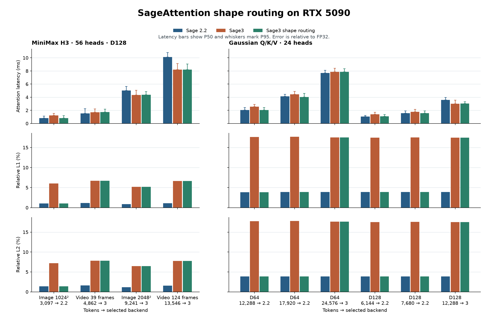

Each cell reports attention P50 and relative L1 error.

| H3 replay | Tokens | Routed backend | Our Sage 2.2 | Our Sage3 | Our Sage3 shape routing |
| --- | ---: | --- | ---: | ---: | ---: |
| Image 1024² | 3,097 | Sage 2.2 | 0.806 ms / 1.06% | 1.218 ms / 6.06% | 0.820 ms / 1.06% |
| Video 768 × 448, 39 frames | 4,862 | Sage3 | 1.546 ms / 1.17% | 1.719 ms / 6.73% | 1.754 ms / 6.73% |
| Image 2048² | 9,241 | Sage3 | 5.012 ms / 0.86% | 4.344 ms / 5.21% | 4.365 ms / 5.21% |
| Video 768 × 448, 124 frames | 13,546 | Sage3 | 10.115 ms / 1.09% | 8.197 ms / 6.63% | 8.213 ms / 6.63% |

At 3,097 tokens, shape routing lowers P50 by **32.7%** and relative L1 from **6.06% to 1.06%** versus direct Sage3. The two longest H3 replays route to Sage3 and cut P50 by **12.9% and 18.8%** versus direct Sage 2.2. The 4,862-token video falls above the calibrated 4,736-token cutoff for fused Q/K/V with 56 heads and head width 128. Direct Sage 2.2 was faster on that replay. For the four Gaussian workloads routed to Sage 2.2, shape routing lowers P50 by **9.5%–23.3%** and relative L1 from about **17.5%–17.7% to 3.9%** versus direct Sage3.

The tests use CUDA events to time the full attention call, including online preprocessing, on Windows with RTX 5090 and PyTorch 2.12.1+cu130. Each arm has 18 warmups and 60 timed calls per sample. H3 uses three layer captures per workload, with Image captures from the public Comfy-Org checkpoint. Gaussian workloads use two seeds. The chart and table report medians across samples. Error uses 96 query positions against FP32 attention with the full K/V sequence and TF32 disabled. All 24 routed outputs matched the outputs of their selected backends bitwise. The process used at most **88 MiB of shared GPU memory** in WDDM sampling. [Per-sample P50, P95, L1, L2, and peak allocation](assets/windows-comparison/shape-routing-benchmark.csv)

## MiniMax H3 Image examples

Both resolutions use the same three prompts and seeds, the public Comfy-Org INT8 ConvRot checkpoint, a black reference image, six-step Euler sampling with CFG 1, and tiled VAE decoding. Within each resolution, the comparison varies the attention backend in the 50 diffusion transformer blocks. The upstream columns use attention logic from `d1a57a5` with the Windows build and launch compatibility changes from `06f8d49`.

### 1024 × 1024

| Scene | cuDNN SDPA | Upstream Sage 2.2 | Our Sage 2.2 | Upstream Sage3 | Our Sage3 | Our Sage3 Shape Routing |
| --- | --- | --- | --- | --- | --- | --- |
| Skin and hair, seed 42 |  |  |  |  |  |  |
| Fine textiles, seed 1234 |  |  | 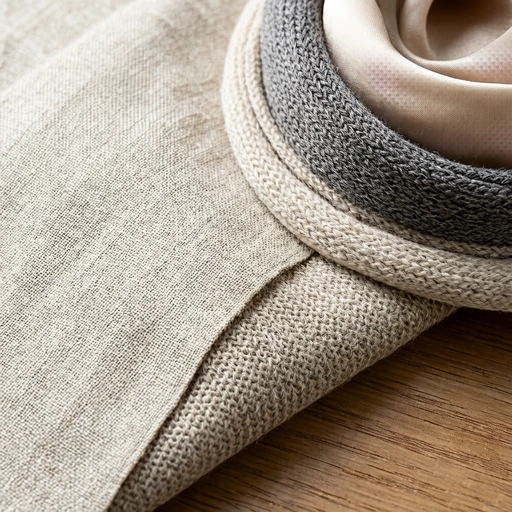 |  |  |  |
| Architecture and geometry, seed 42 | 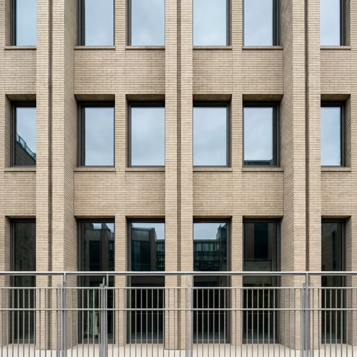 | 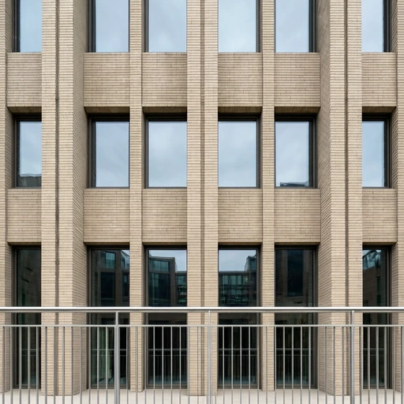 | 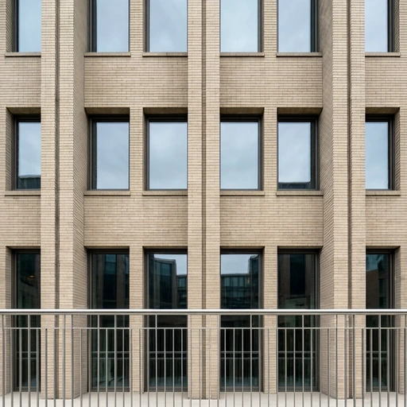 | 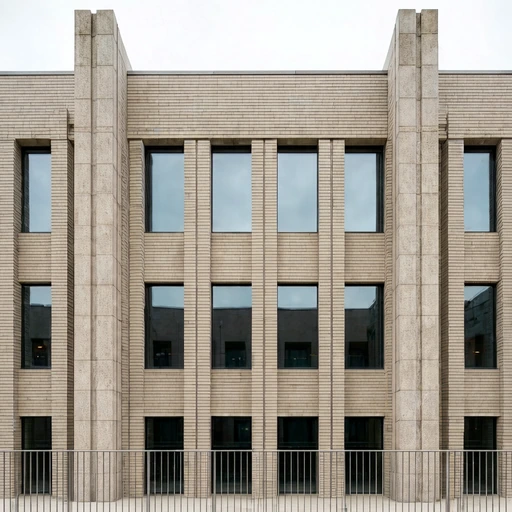 | 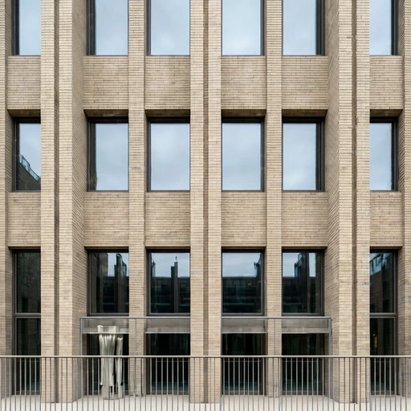 |  |

Sage3 shape routing selected Sage 2.2 for all 300 attention calls per scene at 3,133–3,152 tokens. The routed renders matched the direct Sage 2.2 renders pixel for pixel, so the two columns share their previews. Relative to direct Sage3, shape routing reduced RGB MAE against cuDNN SDPA from **5.97 to 5.12**, **34.77 to 20.56**, and **25.06 to 13.65** on the 0–255 scale. [Per-image MAE, PSNR, and backend counts](assets/windows-comparison/shape-routing-image-metrics.csv)

### 4096 × 4096

The first five columns use the original full-frame renders from the upstream comparison. [RGB error for those renders](assets/windows-comparison/image-metrics.csv)

| Scene | cuDNN SDPA | Upstream Sage 2.2 | Our Sage 2.2 | Upstream Sage3 | Our Sage3 | Our Sage3 Shape Routing |
| --- | --- | --- | --- | --- | --- | --- |
| Skin and hair, seed 42 | 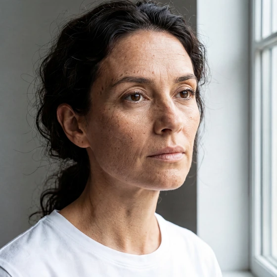 | 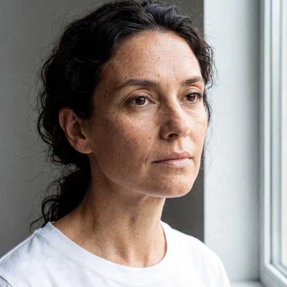 | 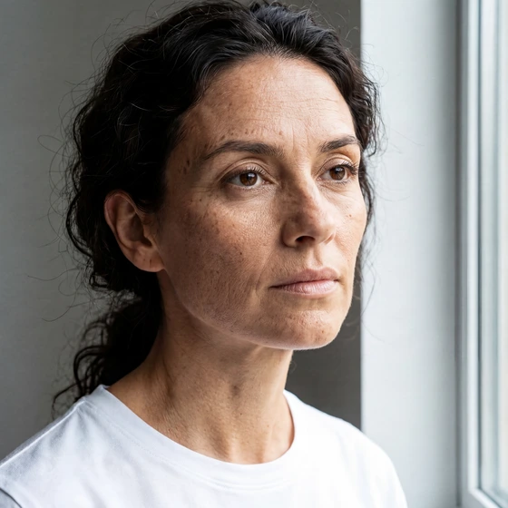 | 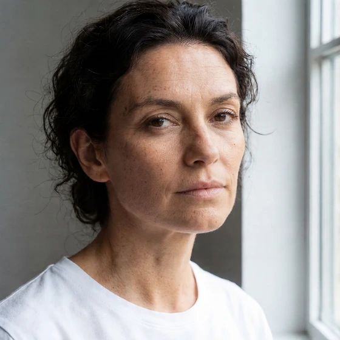 |  | 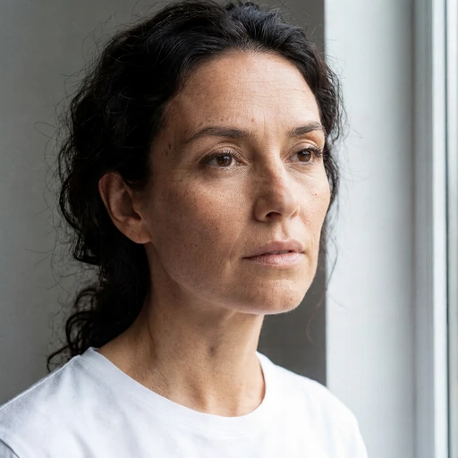 |
| Fine textiles, seed 1234 | 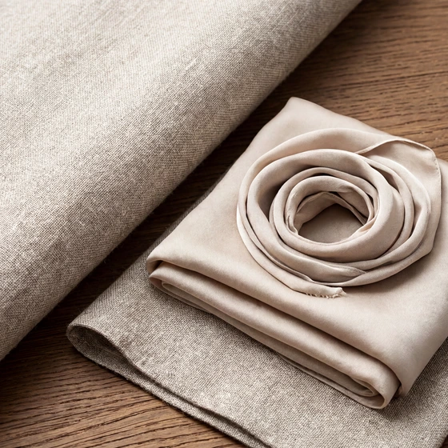 | 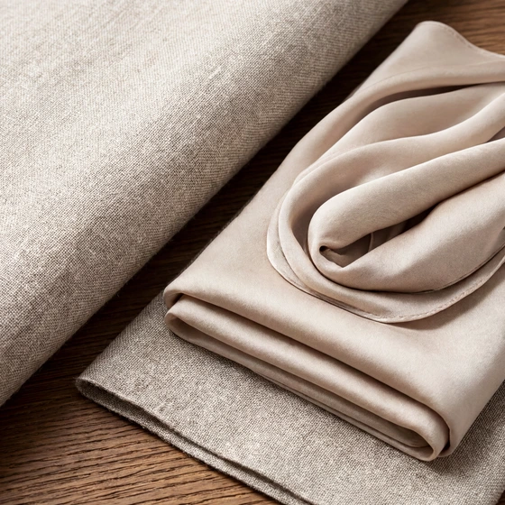 | 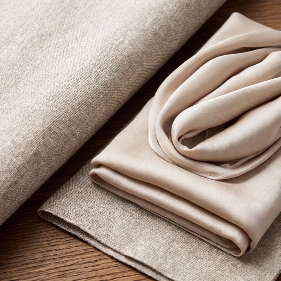 | 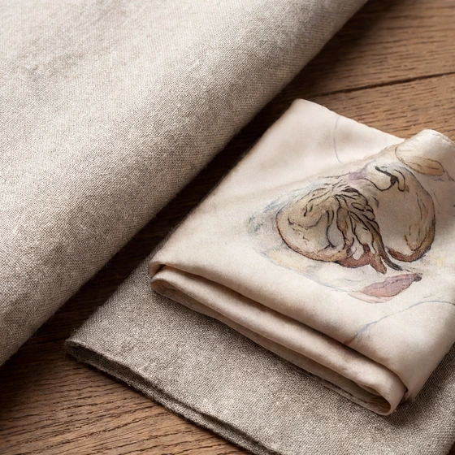 |  | 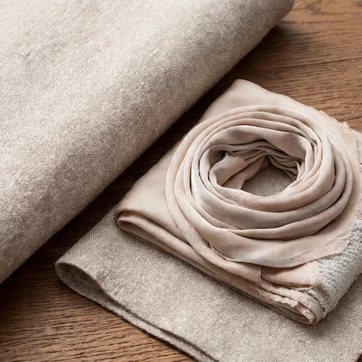 |
| Architecture and geometry, seed 42 | 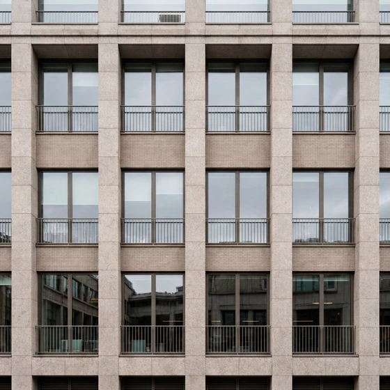 | 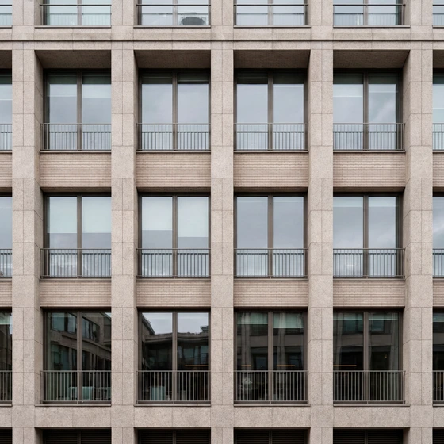 | 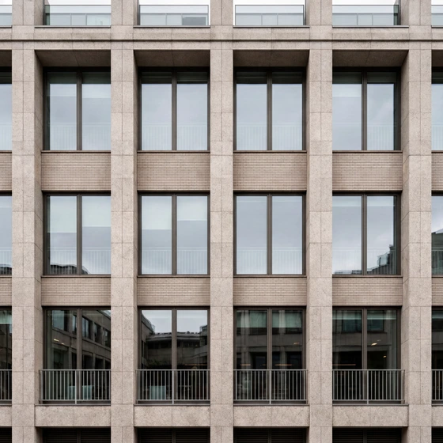 | 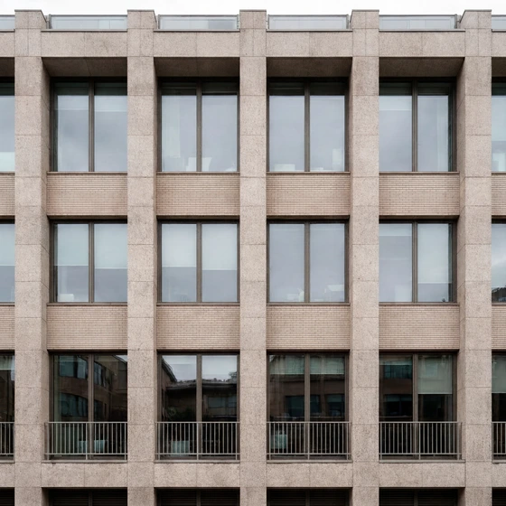 | 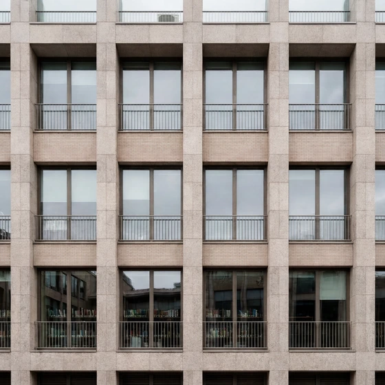 | 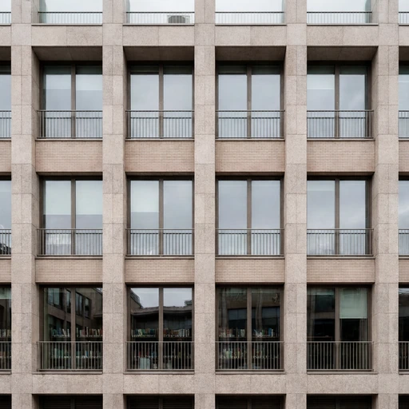 |

Against the cuDNN SDPA reference, our Sage3 lowers RGB MAE and raises PSNR in all three scenes compared with upstream Sage3. The largest MAE drop is in the architecture scene, from 20.98 to 15.92 on the 0–255 RGB scale. Our Sage2.2 lowers MAE for the portrait and raises it for the textiles and architecture scenes.

The new shape routing runs selected Sage3 for all 300 attention calls per scene at 21,565–21,584 tokens. Each routed PNG was byte-identical to a direct Sage3 PNG rendered in the same run.

<details>
<summary>Prompts and sampling settings</summary>

We used `minimax_h3_image_pruned_int8_convrot.safetensors` in ComfyUI 0.45.0 with `qwen3vl_32b_minimax_h3_nvfp4_awq.safetensors` and `minimax_h3_image_vae_fp16.safetensors`. All variants used `--reserve-vram 13 --disable-pinned-memory --disable-async-offload`.  The sigma schedule was `1.0, 0.9675236940383911, 0.8875485062599182, 0.75, 0.5327739119529724, 0.23200887441635132, 0.0`. [Comfy-Org checkpoint](https://huggingface.co/Comfy-Org/MiniMax-H3-Image/blob/0f41fb1c0aa51c560109139537e53ad0dae8ce5e/diffusion_models/minimax_h3_image_pruned_int8_convrot.safetensors)

**Skin and hair**

> A natural-light editorial portrait photograph of an adult woman, age 35, wearing a plain white cotton shirt. Close framing of her face and shoulders, realistic fine pores, subtle freckles, individual loose strands of dark wavy hair, gentle side lighting from a large window, neutral gray background, unretouched photographic texture, accurate anatomy, no text.

**Fine textiles**

> A carefully lit macro product photograph of fine woven linen, knitted wool and a folded silk scarf on a wooden table. Tiny crossing warp and weft threads, dense stitches, subtle fibers, physically plausible folds and soft shadows. Neutral daylight, natural colors, precise textile texture, no text.

**Architecture and geometry**

> A high-resolution architectural photograph of a modern stone library facade, straight vertical columns, evenly spaced rectangular windows, fine brick courses and a regular metal railing. Frontal perspective, crisp geometric alignment, overcast daylight, realistic stone grain, no people, no signs or text.

</details>

## Credits

SageAttention is developed by the original [SageAttention team](https://github.com/thu-ml/SageAttention). Please cite the relevant work if you use these kernels. [SageAttention](https://arxiv.org/abs/2410.02367) · [SageAttention 2](https://arxiv.org/abs/2411.10958) · [SageAttention 2++](https://arxiv.org/abs/2505.21136) · [SageAttention 3](https://arxiv.org/abs/2505.11594)

We thank [woct0rdho](https://github.com/woct0rdho/SageAttention) and [pamparamm](https://github.com/pamparamm) for the Windows build work that helped this fork get started. The examples use the [MiniMax H3 Image model](https://huggingface.co/MiniMaxAI/MiniMax-H3-Image) in [ComfyUI](https://github.com/Comfy-Org/ComfyUI). [Apache 2.0 license](LICENSE)

---

## Original SageAttention README

[Upstream `d1a57a5`](https://github.com/thu-ml/SageAttention/blob/d1a57a546c3d395b1ffcbeecc66d81db76f3b4b5/README.md)

# SageAttention
<!-- We are continuously updating more features. You could **Star** and **Watch** our repository to stay updated.

--- -->
This repository provides the official implementation of SageAttention, SageAttention2, and SageAttention2++, which achieve surprising speedup on most GPUs without lossing accuracy across all models in a plug-and-play way.

**SageAttention: Accurate 8-Bit Attention for Plug-and-play Inference Acceleration**  
Jintao Zhang, Jia Wei, Haofeng Huang, Pengle Zhang, Jun Zhu, Jianfei Chen  
Paper: https://arxiv.org/abs/2410.02367

**SageAttention2: Efficient Attention with Thorough Outlier Smoothing and Per-thread INT4 Quantization**  
Jintao Zhang, Haofeng Huang, Pengle Zhang, Jia Wei, Jun Zhu, Jianfei Chen  
Paper: https://arxiv.org/abs/2411.10958

**SageAttention3: Microscaling FP4 Attention for Inference and An Exploration of 8-Bit Training**  
Jintao Zhang, Jia Wei, Haoxu Wang, Pengle Zhang, Xiaoming Xu, Haofeng Huang, Kai Jiang, Jianfei Chen, Jun Zhu  
Paper: https://arxiv.org/abs/2505.11594


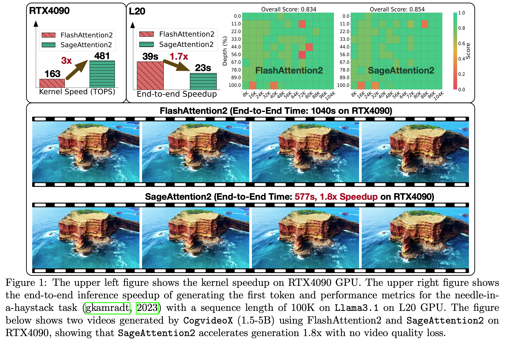
*Note: [SageAttention2++](https://arxiv.org/pdf/2505.21136) achieves higher speed while maintaining the same accuracy performance.*

## Current Features
<!-- This is a beta release of SageAttention2. We welcome any feedback on accuracy, performance issues, bugs, feature requests, or suggestions. Please feel free to open an issue or launch a pull request! -->

+ Optmized kernels for **Ampere, Ada and Hopper GPUs.**
+ INT8 quantization and smoothing for $QK^\top$ with support for varying granularities.
+ FP8 quantization for $PV$, and FP16 accumulator for FP8/FP16 $PV$.
+ Two-level accumulation strategy for $PV$ to improve accuracy in FP8 MMA and WGMMA.
+ Support `torch.compile` with non-cudagraphs mode and distributed inference.


## Project Updates
- [2025-09-27]: 🎉 [SageAttention3](https://arxiv.org/abs/2505.11594) is accepted by NeurIPS 2025 as a **Spotlight** paper! 
- [2025-09-27]: The code of [SageAttention3](https://arxiv.org/abs/2505.11594) is released in this repository at  [sageattention3_blackwell](./sageattention3_blackwell/). We would still greatly appreciate it if you could take a moment to fill out the Form in [Huggingface](https://huggingface.co/jt-zhang/SageAttention3). Please note that since SageAttention2 is more accurate, we still recommend using SageAttention2 for precision-sensitive applications.
- [2025-07-01]: The code of [SageAttention2++](https://arxiv.org/pdf/2505.21136) is released in this repository. We would still greatly appreciate it if you could take a moment to fill out the Form in [Huggingface](https://huggingface.co/jt-zhang/SageAttention2_plus). Thank you very much!

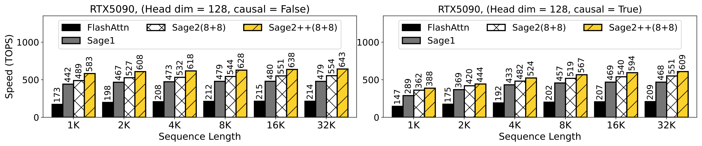

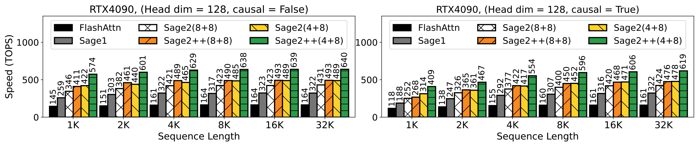

- [2025-06-19]: [Sparse SageAttention1 API](https://github.com/jt-zhang/Sparse_SageAttention_API) and [Sparse SageAttention2 API](https://github.com/thu-ml/SpargeAttn) can compute attention with any block sparse pattern very fast.
- [2025-05-02]: 🎉SageAttention2 and [SpargeAttn](https://github.com/thu-ml/SpargeAttn) are accepted by ICML 2025! 
- [2025-02-25]: 🔥 We release [SpargeAttn](https://github.com/thu-ml/SpargeAttn), a sparse attention based on SageAttention2, which could acclerate any model without training.
- [2025-02-15]: 🔥 The compilation code is updated to support RTX5090! On RTX5090, SageAttention reaches 560T, 2.7x faster than FlashAttention2!
- [2025-01-28]: 🔥⚡SageAttention is now available on Hopper GPUs (H100, H800, H20)! It matches the speed of FlashAttention3-FP8 but offers **much better accuracy!**

| **FlashAttention2** | **FlashAttention3** | **FlashAttention3-FP8** | **SageAttention** |
|----------------------|----------------------|----------------------|----------------------|
|  |   |  |  |
| **25'34''** | **17'32''** | **12'14''** | **12'07''** |

*Results for [CogVideoX1.5-5B](https://huggingface.co/THUDM/CogVideoX1.5-5B) on NVIDIA H20 GPU*

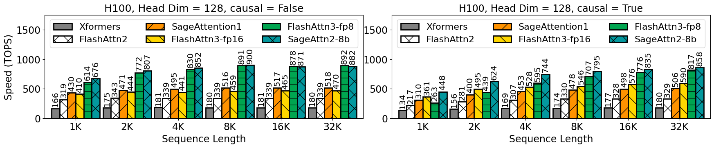

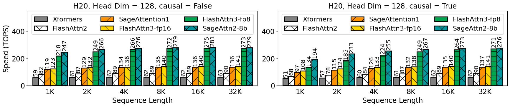

- [2025-01-24]: 🎉SageAttention is accepted by ICLR 2025! 
- [2024-12-20]: 🔥Update the [SageAttention2 Paper](https://arxiv.org/abs/2411.10958).   

- [2024-12-20]: 🔥Release SageAttention 2.0.1 Beta! In this version, we introduce a new feature: per-thread quantization, which offers finer granularity while maintaining hardware efficiency.
- [2024-11-21]: 🔥SageAttention 2.0.0 beta is released! Now SageAttention has measured speedup on L20, L40, A100, A800, and A6000, RTX3090 and RTX4090.
- [2024-11-12]: Support for `sageattn_varlen` is available now.
- [2024-11-11]: Support for different sequence lengths between `q` and `k,v`,  `(batch_size, head_num, seq_len, head_dim)` or `(batch_size, seq_len, head_num, head_dim)` input shapes, and `group-query attention` is available now.


## Installation
### Base environment
+ `python>=3.9`   , `torch>=2.3.0`  , `triton>=3.0.0`
- `CUDA`:
  + `>=12.8` for Blackwell or SageAttention2++
  + `>=12.4` for fp8 support on Ada
  + `>=12.3` for fp8 support on Hopper
  + `>=12.0` for Ampere
+ `flash-attn` for benchmarking

### Install Package

For SageAttention V1 in Triton (slower than SageAttention V2/V2++/V3), refer to [SageAttention-1](https://github.com/thu-ml/SageAttention/tree/sageattention-1) branch and install using pip: `pip install sageattention==1.0.6`

To use SageAttention 2.2.0 (containing SageAttention2++), you can install using pip:
```
pip install sageattention==2.2.0 --no-build-isolation
```

**Or** you can compile from source:
```
git clone https://github.com/thu-ml/SageAttention.git
cd SageAttention 
export EXT_PARALLEL=4 NVCC_APPEND_FLAGS="--threads 8" MAX_JOBS=32 # Optional
python setup.py install
```

To benchmark the speed against FlashAttention3, please compile FlashAttention3 from source:
```
git clone https://github.com/Dao-AILab/flash-attention.git --recursive
git checkout b7d29fb3b79f0b78b1c369a52aaa6628dabfb0d7 # 2.7.2 release
cd hopper
python setup.py install
```

## How to Use
```python
from sageattention import sageattn
attn_output = sageattn(q, k, v, tensor_layout="HND", is_causal=False)
```
+ `q, k, v` are **FP16/BF16** dtype with the shape `(batch_size, head_num, seq_len, head_dim)` using default `tensor_layout="HND"`. For shape `(batch_size, seq_len, head_num, head_dim)`, set `tensor_layout="NHD"`. 
+ `is_causal` determines the use of a causal mask.

### Available APIs:
+ `sageattn`: Automatically selects the optimal kernel based on the GPU to achieve a good performance-accuracy trade-off.
+ `sageattn_qk_int8_pv_fp16_triton`: INT8 quantization for $QK^\top$ and FP16 for $PV$ using Triton backend.
+ `sageattn_qk_int8_pv_fp16_cuda`: INT8 quantization for $QK^\top$ and FP16 for $PV$ using CUDA backend.
+ `sageattn_qk_int8_pv_fp8_cuda`: INT8 quantization for $QK^\top$ and FP8 for $PV$ using CUDA backend. (Note that setting `pv_accum_dtype=fp32+fp16` corresponds to SageAttention2++.)
+ `sageattn_qk_int8_pv_fp8_cuda_sm90`: INT8 quantization for $QK^\top$ and FP8 for $PV$ using CUDA backend, specifically optimized for Hopper GPUs.
+ `sageattn_varlen`: INT8 quantization for $QK^\top$ and FP16 for $PV$ using Triton backend. Support for varying sequence lengths within the same batch.

For optimal speed and accuracy performance on custom devices and models, we strongly recommend referring to the [this file](./sageattention/core.py) for detailed guidance.

> **Note:**
Support for different sequence lengths between `q` and `k,v` and `group-query attention` is available.


### Plug-and-play Example

We can replace `scaled_dot_product_attention` easily. 
We will take [CogvideoX](https://huggingface.co/zai-org/CogVideoX-2b) as an example:

Add the following codes and run
```diff
import torch.nn.functional as F

+ from sageattention import sageattn
+ F.scaled_dot_product_attention = sageattn

```

Specifically,

```bash
cd example
python cogvideox_infer.py --model cogvideox-2b --compile --attention_type sage
```

**You can get a lossless video in** `./example/videos/<model>/<attention_type>/` **faster than by using** `--attention_type sdpa`. More examples and guidance can be found under the `example/` directory.

> **Note:** Not all models works with `F.scaled_dot_product_attention = sageattn`. Technically, you should replace the original Attention by modifying the `Attention Class` of the target model. For image and video models, we suggest only replacing the attention in DiT (see `example/modify_mochi.py` for detail).

### Kernel Benchmarking
We provide a benchmarking script to compare the speed of different kernels including SageAttention, FlashAttention2 and FlashAttention3. Please refer to the `benchmark/` directory for more details.
 
## Performance
### Speed of Kernels

`8+8` means the kernel with INT8 quantization for $QK^\top$ and FP8 quantization for $PV$. `8+16` uses FP16 with FP16 accumulator for $PV$.


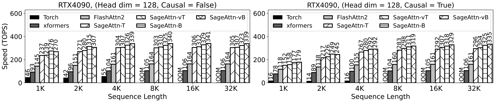

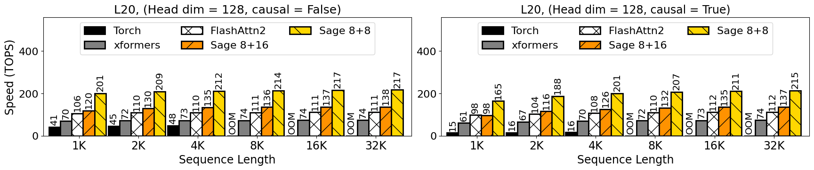


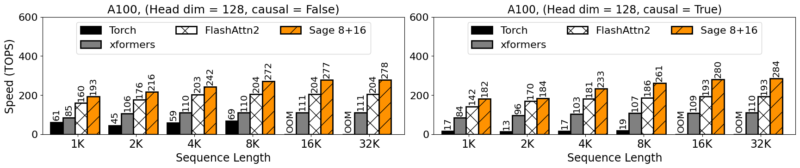

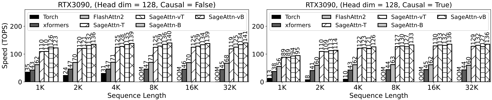

> **Note:** The TOPS results refer only to the Attention Kernel, excluding the quantization and smoothing.

### End-to-end Performance
#### **End-to-End Accuracy:**


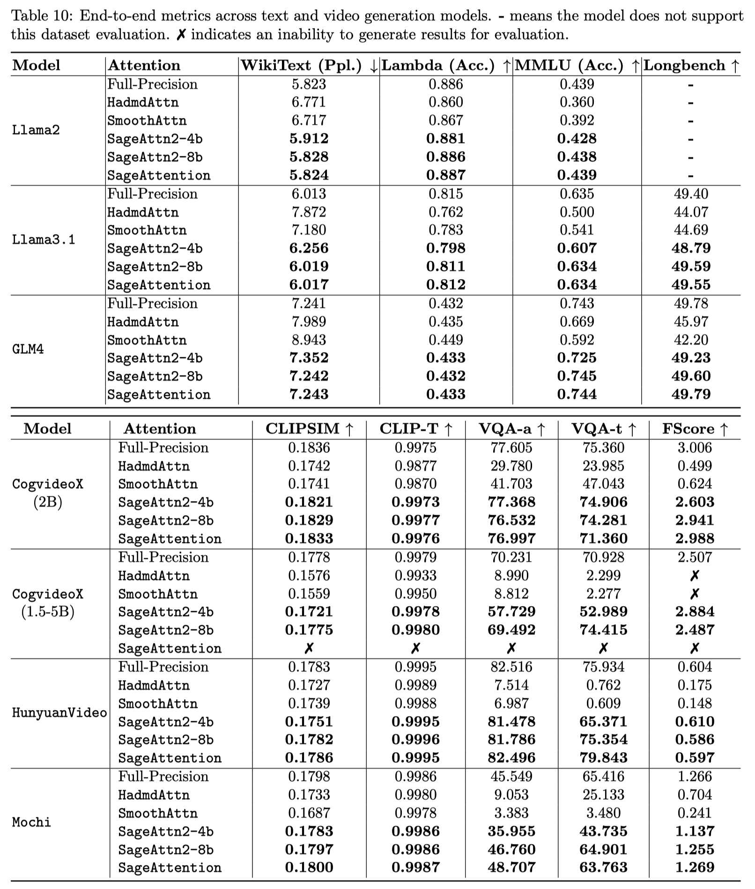

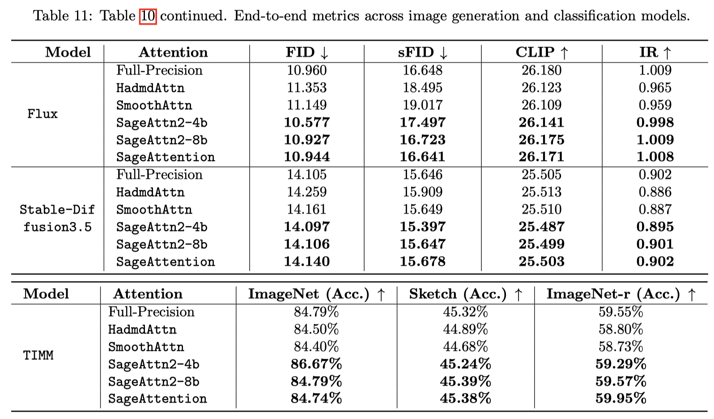

#### **End-to-End Speedup:**

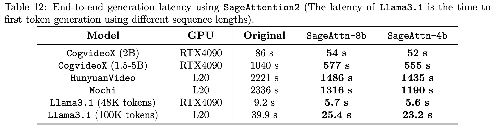
*Note: SageAttention2++ achieves higher speed.*

## Citation
**If you use this code or find our work valuable, please cite:**
```
@inproceedings{zhang2025sageattention,
  title={SageAttention: Accurate 8-Bit Attention for Plug-and-play Inference Acceleration}, 
  author={Zhang, Jintao and Wei, Jia and Zhang, Pengle and Zhu, Jun and Chen, Jianfei},
  booktitle={International Conference on Learning Representations (ICLR)},
  year={2025}
}
@inproceedings{zhang2024sageattention2,
  title={Sageattention2: Efficient attention with thorough outlier smoothing and per-thread int4 quantization},
  author={Zhang, Jintao and Huang, Haofeng and Zhang, Pengle and Wei, Jia and Zhu, Jun and Chen, Jianfei},
  booktitle={International Conference on Machine Learning (ICML)},
  year={2025}
}
@article{zhang2025sageattention2++,
  title={Sageattention2++: A more efficient implementation of sageattention2},
  author={Zhang, Jintao and Xu, Xiaoming and Wei, Jia and Huang, Haofeng and Zhang, Pengle and Xiang, Chendong and Zhu, Jun and Chen, Jianfei},
  journal={arXiv preprint arXiv:2505.21136},
  year={2025}
}
@article{zhang2025sageattention3,
  title={SageAttention3: Microscaling FP4 Attention for Inference and An Exploration of 8-Bit Training},
  author={Zhang, Jintao and Wei, Jia and Zhang, Pengle and Xu, Xiaoming and Huang, Haofeng and Wang, Haoxu and Jiang, Kai and Zhu, Jun and Chen, Jianfei},
  journal={arXiv preprint arXiv:2505.11594},
  year={2025}
}
```
