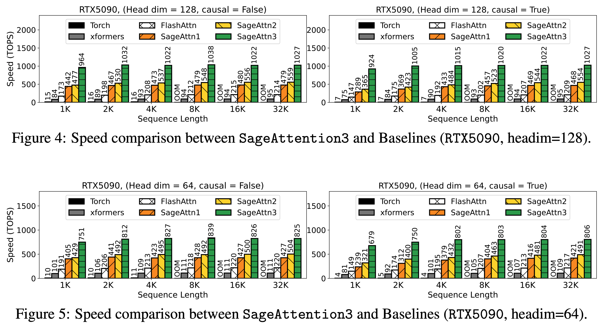
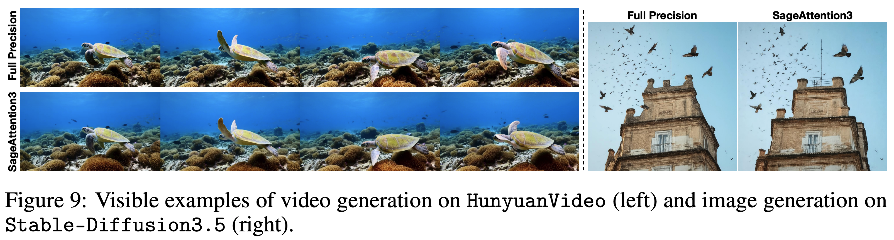

# SageAttention3
<!-- We are continuously updating more features. You could **Star** and **Watch** our repository to stay updated.

--- -->
This repository provides the official implementation of SageAttention3

**SageAttention3: Microscaling FP4 Attention for Inference and An Exploration of 8-Bit Training**  
Paper: https://arxiv.org/abs/2505.11594  
Jintao Zhang, Jia Wei, Pengle Zhang, Xiaoming Xu, Haofeng Huang, Haoxu Wang, Kai Jiang, Jun Zhu, Jianfei Chen

# Limitaitions:
Currently, SageAttention3 works well for: 
1. Video generation models: CogVideoX-2B, HunyuanVideo, Mochi.
2. Almost all image generation models, including Flux and Stable-Diffusion3.5.

**Note: SageAttention3 does not guarantee lossless acceleration for all models. For other video generation models, we recommend selectively using SageAttention2++ in certain layers or timesteps.**  

For example:  
- Apply **SageAttention2++** only at the **first and last timesteps**,  
- Use **SageAttention3** for all the others.  

This hybrid approach may achieve **lossless acceleration**.  

## Installation
### Base environment
+ CPython 3.10 or newer. The `cp310-abi3` wheels require a compatible PyTorch and CUDA build.
+ CUDA 12.8 or newer and a supported Blackwell GPU.
+ See the [Windows build matrix](../README.md#what-this-fork-provides) for verified Python/PyTorch combinations, including Python 3.12 with PyTorch 2.7.1.

### Install Package

To use SageAttention3, please **compile from source**:
```
git clone https://github.com/thu-ml/SageAttention
cd SageAttention/sageattention3_blackwell 
python setup.py install
```


## How to Use
```python
from sageattn3 import sageattn3_blackwell
attn_output = sageattn3_blackwell(q, k, v, is_causal=False)
```
+ `q, k, v` are **FP16/BF16** dtype with the shape `(batch_size, head_num, seq_len, head_dim)` 
+ `is_causal` uses a right-aligned causal mask. Causal sequences require `q_len <= kv_len`.
+ Q may have more heads than K/V when its head count is a multiple of theirs (GQA/MQA).
+ Head widths up to 128 are padded to the next supported FP4 width (64 or 128). The default `sm_scale` uses the original width. `scale` is an alias for `sm_scale`.
+ Explicit `attn_mask` values are passed to PyTorch SDPA. Q and K with different amounts of causal sequence padding also use SDPA with a right-aligned mask.
+ Preprocessing leaves the caller's K tensor intact.

On Windows with RTX 5090 and PyTorch 2.12.1+cu130, eager calls can use the compatible SageAttention 2.2 wheel from this fork for calibrated BF16 self-attention shapes. The cutoff depends on head count, head width and tensor strides. This applies to batch size 1 with per-block means, equal Q/K/V shapes and no mask or explicit chunking. Other shapes and environments use the original SageAttention 3 dispatch.

For long non-causal attention with `per_block_mean=True`, the FP4 path automatically chunks Q when the full correction tensor exceeds the TMA stride limit. You can also set `q_chunk_size` to a positive multiple of 128 to bound the size of that tensor. The chunks reuse the quantized K and V tensors. See [#394](https://github.com/thu-ml/SageAttention/pull/394).

For each 16-element Q and K block, the CUDA quantizer tries `amax / t` with
`t` in `{6, 5.5, 5, 4.5, 4}`. It selects the E4M3 scale with the lowest NVFP4
reconstruction error. The approach extends [Four Over Six](https://arxiv.org/abs/2512.02010).

For each channel of V, the quantizer scores the E4M3 representation of `amax / 6`
and its two adjacent finite encodings over 16 consecutive tokens. It stores the
scale with the lowest NVFP4 reconstruction error. This search is inspired by
[ScaleSweep](https://arxiv.org/abs/2606.07618).

## Performance
### Speed of Kernels


### Video and Image Generation Examples



## Citation
**If you use this code or find our work valuable, please cite:**
```
@inproceedings{zhang2025sageattention,
  title={SageAttention: Accurate 8-Bit Attention for Plug-and-play Inference Acceleration}, 
  author={Zhang, Jintao and Wei, Jia and Zhang, Pengle and Zhu, Jun and Chen, Jianfei},
  booktitle={International Conference on Learning Representations (ICLR)},
  year={2025}
}
@inproceedings{zhang2024sageattention2,
  title={Sageattention2: Efficient attention with thorough outlier smoothing and per-thread int4 quantization},
  author={Zhang, Jintao and Huang, Haofeng and Zhang, Pengle and Wei, Jia and Zhu, Jun and Chen, Jianfei},
  booktitle={International Conference on Machine Learning (ICML)},
  year={2025}
}
@article{zhang2025sageattention2++,
  title={Sageattention2++: A more efficient implementation of sageattention2},
  author={Zhang, Jintao and Xu, Xiaoming and Wei, Jia and Huang, Haofeng and Zhang, Pengle and Xiang, Chendong and Zhu, Jun and Chen, Jianfei},
  journal={arXiv preprint arXiv:2505.21136},
  year={2025}
}
@article{zhang2025sageattention3,
  title={SageAttention3: Microscaling FP4 Attention for Inference and An Exploration of 8-Bit Training},
  author={Zhang, Jintao and Wei, Jia and Zhang, Pengle and Xu, Xiaoming and Huang, Haofeng and Wang, Haoxu and Jiang, Kai and Zhu, Jun and Chen, Jianfei},
  journal={arXiv preprint arXiv:2505.11594},
  year={2025}
}
```
